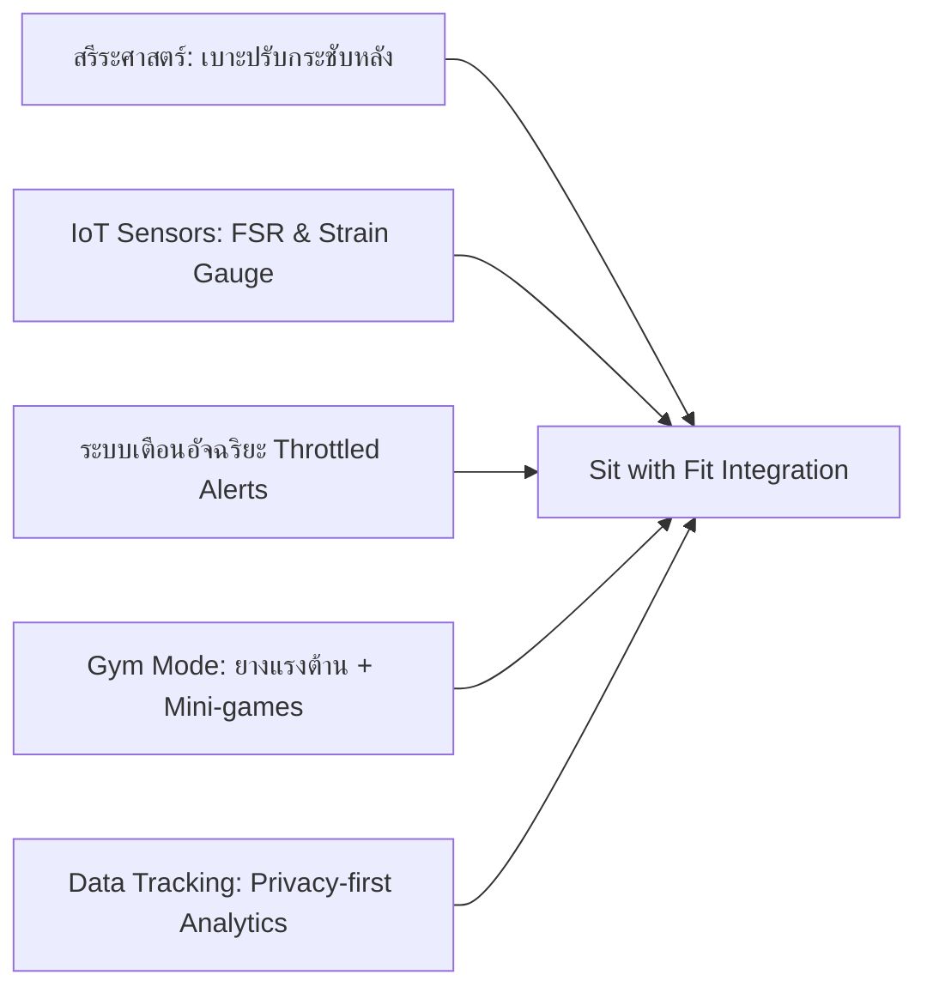
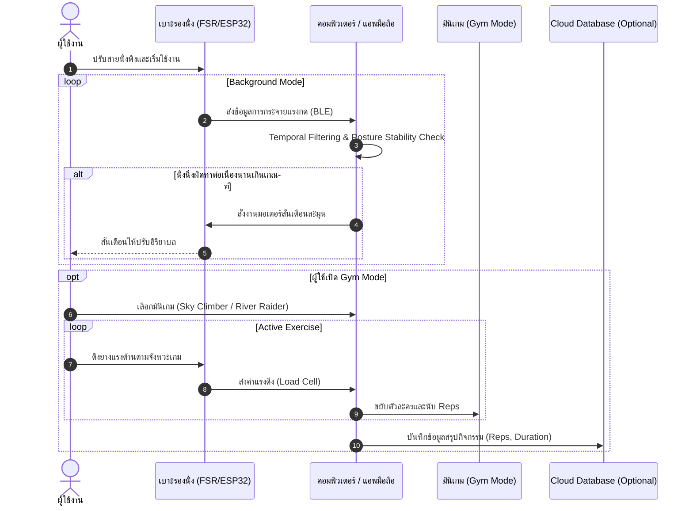

# Sit with Fit — สรุปโครงการและแนวทางพัฒนาจากตัวอย่าง Lifted Lumbar

> **เอกสารสรุปโครงการสำหรับใช้พัฒนาต้นแบบ ทำรายงาน และเตรียมตอบคำถามกรรมการ**  
> **วันที่จัดทำ:** 17 ตุลาคม 2026  
> **สถานะเอกสาร:** แผนพัฒนาและกรอบแนวคิดเชิงวิศวกรรม (Conceptual & Prototype Strategy)  
> *หมายเหตุ: คะแนนในส่วนซ้อมตอบกรรมการเป็นข้อเสนอแนะเชิงคุณภาพจากการสนทนา ไม่ใช่ผลการทดสอบทางวิศวกรรมหรือคะแนนจากกรรมการจริง*

---

## สารบัญ (Table of Contents)
1. [บทสรุปผู้บริหาร (Executive Summary)](#1-บทสรุปผู้บริหาร-executive-summary)
2. [ปัญหาและกลุ่มผู้ใช้เป้าหมาย (Problem & Target Audience)](#2-ปัญหาและกลุ่มผู้ใช้เป้าหมาย-problem--target-audience)
3. [แนวคิดการทำงานและองค์ประกอบระบบ (Concept & System Architecture)](#3-แนวคิดการทำงานและองค์ประกอบระบบ-concept--system-architecture)
4. [การศึกษาตัวอย่าง Lifted Lumbar (Case Study Benchmark)](#4-การศึกษาตัวอย่าง-lifted-lumbar-case-study-benchmark)
5. [จุดขายและการนำเสนอคุณค่า (Value Proposition & USP)](#5-จุดขายและการนำเสนอคุณค่า-value-proposition--usp)
6. [แผนต้นแบบและการทดสอบ (Prototyping & Validation Plan)](#6-แผนต้นแบบและการทดสอบ-prototyping--validation-plan)
7. [ความปลอดภัยและความเป็นส่วนตัว (Safety & Privacy Engineering)](#7-ความปลอดภัยและความเป็นส่วนตัว-safety--privacy-engineering)
8. [ความเสี่ยงและแนวทางรับมือ (Risk Assessment & Mitigation)](#8-ความเสี่ยงและแนวทางรับมือ-risk-assessment--mitigation)
9. [โมเดลธุรกิจและโครงสร้างต้นทุน (Business Model & BOM Economics)](#9-โมเดลธุรกิจและโครงสร้างต้นทุน-business-model--bom-economics)
10. [แนวทางตอบคำถามกรรมการ: สรุปการซ้อม 20 รอบ (Committee Defense Matrix)](#10-แนวทางตอบคำถามกรรมการ-สรุปการซ้อม-20-รอบ-committee-defense-matrix)
11. [แผนงานที่แนะนำ (Actionable Roadmap)](#11-แผนงานที่แนะนำ-actionable-roadmap)
12. [สคริปต์นำเสนอ 60 วินาที (Elevator Pitch)](#12-สคริปต์นำเสนอ-60-วินาที-elevator-pitch)
13. [แหล่งอ้างอิง (References)](#13-แหล่งอ้างอิง-references)

---

## 1. บทสรุปผู้บริหาร (Executive Summary)

**Sit with Fit** เป็นแนวคิดเบาะรองนั่งอัจฉริยะที่ออกแบบมาเพื่อส่งเสริม **"การนั่งอย่างมีสติ" (Mindful Sitting)** และ **"การเคลื่อนไหวสม่ำเสมอระหว่างวัน" (Active Micro-movements)** สำหรับกลุ่มผู้ใช้นั่งทำงาน เรียน หรือเล่นเกมเป็นเวลานาน โดยผสานการรองรับสรีระหลังส่วนล่าง (Ergonomic Lumbar Support) เข้ากับระบบเซนเซอร์ตรวจจับพฤติกรรม, ระบบแจ้งเตือนอัจฉริยะที่ไม่รบกวนสมาธิ, มินิเกมออกกำลังกายแบบสั้น (Micro-break Games) และระบบบันทึกความต่อเนื่องของการใช้งาน



### โหมดการทำงานหลัก 2 รูปแบบ
1. **Background Mode (โหมดเฝ้าระวังเบื้องหลัง):** ตรวจจับสัญญาณการเปลี่ยนท่าทางหรือการนั่งต่อเนื่องเป็นเวลานาน จากนั้นแจ้งเตือนแบบละมุน (Gentle Alert) ด้วยระบบสั่นหรือเสียง เพื่อกระตุ้นให้ผู้ใช้ปรับท่านั่งหรือลุกเปลี่ยนอิริยาบถ
2. **Active/Gym Mode (โหมดมินิยิม):** ชวนผู้ใช้ทำกิจกรรมยืดเหยียดและออกกำลังกายกล้ามเนื้อแกนกลาง/หลังส่วนบนด้วยยางแรงต้าน (Resistance Bands) ร่วมกับมินิเกมขนาดสั้น (เช่น ท่าดึงลงคล้าย *Lat Pulldown* หรือท่าดึงเข้าหาตัวคล้าย *Seated Row*)

> **จุดขายที่ต้องพิสูจน์:** ไม่ใช่แค่ "เบาะนั่งสบาย" ทั่วไป แต่คือการเชื่อมโยง **การรองรับทางกายภาพ + การรับรู้พฤติกรรม + การเตือนที่พอดี + กิจกรรมกระตุ้นการขยับ + การติดตามต่อเนื่อง** ไว้ในประสบการณ์เดียวกัน โดยต้องผ่านการทดสอบความแม่นยำ ความปลอดภัย ความสบาย และความคุ้มค่าก่อนการกล่าวอ้างผลลัพธ์

---

## 2. ปัญหาและกลุ่มผู้ใช้เป้าหมาย (Problem & Target Audience)

### ปัญหาที่ต้องการแก้ไข (Pain Points)
- **การนั่งนิ่งนานเกินไป:** ผู้ใช้นั่งทำงาน เรียน หรือเล่นเกมต่อเนื่องหลายชั่วโมงโดยไม่รู้ตัว
- **ขาดการตระหนักรู้ในอิริยาบถ:** ผู้ใช้อาจเปลี่ยนเป็นท่านั่งงอตัว ไหล่ห่อ หรือทิ้งน้ำหนักเอียงโดยไม่ทันสังเกต
- **ความรำคาญจากการเตือนผิดพลาด (Alert Fatigue):** ระบบแจ้งเตือนแบบเดิมในท้องตลาดมักเตือนบ่อยเกินไป (False Alarms) หรือเตือนขัดจังหวะการทำงาน จนผู้ใช้เลือกปิดระบบถาวร
- **อุปสรรคในการออกกำลังกายระหว่างวัน:** การเริ่มต้นออกกำลังกายระหว่างวันทำได้ยาก รู้สึกน่าเบื่อ หรือต้องเตรียมอุปกรณ์ยุ่งยาก
- **ความกังวลเรื่องข้อมูลส่วนบุคคล:** ความระแวงเรื่องการเปิดกล้องเว็บแคมหรือการบันทึกข้อมูลส่วนบุคคลในพื้นที่ทำงาน/ที่พักอาศัย

### กลุ่มเป้าหมายเริ่มต้น (Initial Target Segments)
```
[นักเรียน / นักศึกษา]          [คนทำงานออฟฟิศ / Work from Home]
  - นั่งอ่านหนังสือ/คอมพิวเตอร์นาน       - เสี่ยงต่ออาการปวดเมื่อยสะสม
  - ชอบสื่อและเกมการแข่งขัน             - ต้องการอุปกรณ์ช่วยเตือนสติที่ไม่รบกวนงาน
         │                                      │
         └───────────────┬──────────────────────┘
                         │
         ┌───────────────┴──────────────────────┐
         │                                      │
[ผู้เล่นเกม / Streamers]        [สถาบัน / ฝ่ายทรัพยากรบุคคล (B2B)]
  - นั่งโฟกัสหน้าจอนานเป็นพิเศษ        - ต้องการโครงการทดลองส่งเสริมสุขภาวะพนักงาน
  - ต้องการความคล่องตัวและลูกเล่นดิจิทัล - ต้องการข้อมูลภาพรวมที่ปลอดภัยด้าน PDPA
```

> [!IMPORTANT]
> **หลักการสำคัญ:** ต้องเริ่มทดสอบกับกลุ่มเล็กที่เข้าถึงได้และควบคุมตัวแปรได้ก่อน (Small-batch Cohort) เพื่อนำข้อมูลจริงมาปรับปรุงระบบ ห้ามเริ่มต้นด้วยการอ้างว่าผลิตภัณฑ์ "รักษาอาการทางการแพทย์" หรือ "เหมาะกับทุกคนอย่างไร้ขีดจำกัด"

---

## 3. แนวคิดการทำงานและองค์ประกอบระบบ (Concept & System Architecture)

### 3.1 สถาปัตยกรรมฮาร์ดแวร์ (Proposed Hardware Architecture)

| องค์ประกอบ | หน้าที่ที่ตั้งใจใช้ | ข้อควรระวังและการจัดการความเสี่ยง |
| :--- | :--- | :--- |
| **เบาะและส่วนรองรับหลังส่วนล่าง (Adjustable Lumbar Cushion)** | ช่วยให้ผู้ใช้ปรับระดับความกระชับ ความสูง และตำแหน่งรองรับกระดูกสันหลังส่วนเอวให้เข้ากับสรีระ | ต้องทดสอบความสบายของวัสดุโฟม ขนาดที่รองรับเก้าอี้หลากรุ่น ความมั่นคง และการป้องกันการลื่นไถล |
| **เซนเซอร์แรงกด (FSR Grid)** | ติดตั้งที่เบาะรองนั่งและพนักพิง เพื่อตรวจจับการกระจายน้ำหนักและการขยับเปลี่ยนท่าทาง | *แรงกดไม่สามารถยืนยัน "ท่าทางที่ถูกต้องตามหลักสรีรศาสตร์" ได้โดยลำพัง* ต้องใช้การกรองสัญญาณร่วมกับเวลา |
| **Load Cell / Strain Gauge** | ติดตั้งบริเวณจุดเกี่ยวยางแรงต้าน เพื่อประเมินแรงดึงและนับรอบการออกกำลังกายใน Gym Mode | ต้องสอบเทียบ (Calibrate) ค่าสม่ำเสมอ และมีกลไกจำกัดแรงเพื่อความปลอดภัยเชิงกล |
| **ไมโครคอนโทรลเลอร์ ESP32** | อ่านค่าแอนะล็อก/ดิจิทัล ประมวลผลขั้นต้น (Edge Filtering) และส่งข้อมูลผ่าน Wi-Fi/Bluetooth LE | ต้องออกแบบระบบจัดการการเชื่อมต่อหลุด (Reconnection logic) และบัฟเฟอร์ข้อมูลออฟไลน์ |
| **Buzzer / Haptic Vibration Motor** | ให้สัญญาณตอบรับและแจ้งเตือนผู้ใช้เมื่อนั่งนิ่งนานหรือถึงเวลาเปลี่ยนท่า | ต้องปรับระดับความแรงได้ มีโหมดเงียบ (Vibration only) และมี Logic หน่วงเวลาลดการเตือนถี่เกินไป |
| **กล้องเว็บแคม (ตัวเลือกเสริม / Optional)** | ใช้ตรวจจับโครงร่างร่างกาย (Pose Estimation) เพื่อเพิ่มความแม่นยำในการระบุทิศทางการเอียงตัว | **ต้องมีโหมดไม่ใช้กล้องเสมอ** ประมวลผลภาพบนเครื่อง (Edge CV) ไม่ส่งภาพดิบขึ้นคลาวด์ และต้องขอความยินยอมชัดเจน |

### 3.2 สถาปัตยกรรมซอฟต์แวร์และข้อมูล (Software & Data Flow)
- **Edge Vision Engine (ทางเลือก):** MediaPipe Pose Estimation สำหรับจับพิกัดข้อต่อร่างกาย (Shoulder, Hip, Spine angle) ใช้งานเฉพาะเมื่อผู้ใช้เปิดกล้องและอยู่ในสภาพแสงที่รองรับ
- **Gamification Mini-games:**
  - *Sky Climber:* มินิเกมปีนเขาโดยใช้ท่าดึงลงจากด้านบน (Lat Pulldown variation)
  - *River Raider:* มินิเกมพายเรือผ่านการดึงยางเข้าหาลำตัว (Seated Row variation)
- **Data Logging & Storage:**
  - จัดเก็บ: เวลาการใช้งานจริง (Active session), เวลานั่งต่อเนื่อง (Continuous sitting duration), จำนวนครั้งกิจกรรม (Rep count), และคะแนนท่าทางที่นิยามอย่างโปร่งใส
  - โครงสร้างคลาวด์: Firebase / Supabase เป็นทางเลือกสำหรับซิงก์ข้อมูลแดชบอร์ด
- **Dashboard:** แดชบอร์ดสรุปแนวโน้มพฤติกรรมการนั่งรายวัน/รายสัปดาห์ เน้นการเปรียบเทียบพฤติกรรมตนเอง ไม่ใช้คำศัพท์วินิจฉัยทางการแพทย์



---

## 4. การศึกษาตัวอย่าง Lifted Lumbar (Case Study Benchmark)

### 4.1 ข้อมูลที่ตรวจสอบได้จากแคมเปญจริง
1. **Kickstarter Campaign (รุ่นแรก):** ยอดระดมทุนประสบความสำเร็จสูงถึง **US$1,142,740** (ทะลุเป้าหมาย $10,000) จากผู้สนับสนุน **12,873 คน**
2. **แบรนด์ผู้สร้าง:** Doctor Trigger (นำเสนอความเป็นเบาะที่ออกแบบโดยแพทย์สำหรับปรับสรีระและบรรเทาอาการปวดหลัง)
3. **Lifted Lumbar Seat Gym (แคมเปญรุ่นต่อยอด):** ข้อมูลสาธารณะที่ระบุบนหน้าเว็บมีจำกัด ยืนยันได้ว่าเป็นแนวคิดการรวมยางแรงต้านเข้ากับเบาะนั่ง แต่ยังไม่มีรายงานผลทดสอบทางคลินิกหรือรายละเอียดเซนเซอร์อิเล็กทรอนิกส์สาธารณะ

### 4.2 บทเรียนสำคัญจากการออกแบบของ Lifted Lumbar
- การใช้ **สายรัดปรับระดับ (Adjustable Straps)** ช่วยให้ผู้ใช้สามารถปรับแรงดันส่วนหลังให้เข้ากับสรีระเก้าอี้แต่ละแบบได้ดี
- การใช้วัสดุโฟมคืนรูปคุณภาพสูงร่วมกับปลอกผ้าที่ระบายอากาศและแผ่นกันลื่นใต้เบาะ เป็นหัวใจสำคัญของความรู้สึกสบาย (Comfort & Ergonomic Appeal)
- การสื่อสารคุณค่าเน้นเรื่องความสะดวกในการพกพาและใช้งานง่าย

### 4.3 ตารางเปรียบเทียบ: Lifted Lumbar vs. Sit with Fit

| มิติการเปรียบเทียบ | Lifted Lumbar (รุ่นเดิมที่เปิดตัว) | Sit with Fit (แนวคิดโครงการ) |
| :--- | :--- | :--- |
| **คุณค่าหลัก (Core Value)** | อุปกรณ์พยุงสรีระหลังส่วนล่างแบบกายภาพ (Passive Ergonomics) | ผสานการพยุงสรีระเข้ากับการตระหนักรู้พฤติกรรมและการขยับกาย (Active & Cognitive Ergonomics) |
| **การปรับแต่งตามบุคคล** | ปรับสายรัดตามความรู้สึกของผู้ใช้ | ปรับความกระชับสายรัด + กำหนดเกณฑ์เวลาและระดับการเตือนผ่านซอฟต์แวร์ |
| **ระบบตรวจจับอิเล็กทรอนิกส์** | ไม่มี (เน้นรูปทรงกายภาพ) | FSR Grid ตรวจจับแรงกด + เซนเซอร์วัดแรงดึง + ตัวเลือกกล้อง MediaPipe |
| **การส่งเสริมการเคลื่อนไหว** | ไม่ปรากฏระบบดิจิทัลในรุ่นเดิม | มินิเกม (Sky Climber, River Raider) ชักชวนขยับกล้ามเนื้อหลัง/ไหล่ |
| **การติดตามและรายงานผล** | ไม่มีระบบบันทึกข้อมูล | แดชบอร์ดสรุปเวลาใช้งาน การขยับตัว และสถิติกิจกรรม |
| **ความเสี่ยงทางวิศวกรรม** | ด้านวัสดุศาสตร์ ความทนทาน และความพอดีทางกายภาพ | เพิ่มความเสี่ยงด้านความปลอดภัยของยางยืด, ความแม่นยำเซนเซอร์, ความเสถียรซอฟต์แวร์, และความเป็นส่วนตัว |

> [!TIP]
> **ข้อสรุปเชิงกลยุทธ์:** อย่านำเสนอว่า Sit with Fit มี "เบาะที่นุ่มกว่าหรือพยุงหลังดีกว่า Lifted Lumbar" โดยไม่มีผลทดสอบรองรับ แต่ให้นำเสนอจุดต่างที่ชัดเจน คือ **การเปลี่ยนเบาะธรรมดาให้เป็นระบบส่งเสริมพฤติกรรม (Behavioral Feedback Loop)**

---

## 5. จุดขายและการนำเสนอคุณค่า (Value Proposition & USP)

### ข้อความนำเสนอหลัก (Core Value Proposition)
> **"Sit with Fit คือเบาะรองนั่งอัจฉริยะที่ผสานการรองรับสรีระเข้ากับระบบเตือนสติและมินิเกมกิจกรรมสั้น ๆ เพื่อช่วยให้ผู้ใช้ตระหนักรู้ในพฤติกรรมการนั่ง และมีโอกาสขยับร่างกายระหว่างวันได้อย่างสม่ำเสมอและปลอดภัย"**

### คุณค่า 5 ประการที่ต้องพิสูจน์ด้วยหลักฐานเชิงประจักษ์ (Empirical Proof Points)
1. **Sensing Feasibility:** ตรวจจับการเปลี่ยนแปลงของท่านั่งได้แม่นยำเพียงพอในสภาพแวดล้อมใช้งานจริง
2. **Alert Acceptance:** ระบบการเตือนไม่สร้างความรำคาญหรือรบกวนสมาธิ (Low False-Alarm Rate)
3. **Gamification Stickiness:** มินิเกมกระตุ้นให้ผู้ใช้เริ่มและทำกิจกรรมต่อเนื่องได้จริง ดีกว่าการส่งข้อความเตือนเพียงอย่างเดียว
4. **Mechanical & Ergonomic Safety:** เบาะและยางแรงต้านใช้งานได้สบาย มั่นคง และปลอดภัยตามข้อกำหนด
5. **Transparent Analytics:** แดชบอร์ดให้ข้อมูลที่เป็นประโยชน์ ช่วยสะท้อนพฤติกรรมโดยไม่กล่าวอ้างเกินหลักฐาน

```
┌────────────────────────────────────────────────────────┐
│           ข้อกำหนดสำคัญในการสื่อสาร (Ground Rule)        │
├────────────────────────────────────────────────────────┤
│ ห้ามใช้คำกล่าวอ้างว่า:                                    │
│  ❌ "รักษาอาการออฟฟิศซินโดรมหรือโรคปวดหลังให้หายขาด"       │
│  ❌ "ป้องกันกระดูกสันหลังคดได้ 100%"                     │
│  ❌ "การันตีว่าท่านั่งของผู้ใช้ถูกต้องสมบูรณ์แบบตลอดเวลา"   │
│                                                        │
│ ให้ใช้คำที่สะท้อนขอบเขตจริง:                               │
│  ✅ "ช่วยส่งเสริมการตระหนักรู้ในอิริยาบถการนั่ง"          │
│  ✅ "กระตุ้นให้เกิดการเคลื่อนไหวเพื่อลดการนั่งนิ่งนาน"      │
│  ✅ "ติดตามแนวโน้มพฤติกรรมการใช้งานเพื่อการปรับปรุงตนเอง"  │
└────────────────────────────────────────────────────────┘
```

---

## 6. แผนต้นแบบและการทดสอบ (Prototyping & Validation Plan)

### 6.1 ลำดับการพัฒนา 4 ระยะเพื่อลดความเสี่ยง (4-Phase De-risking Roadmap)

```
[Phase 1: MVP ขั้นต่ำ]
  │  - เบาะรองรับ + FSR Sensor พื้นฐาน + ESP32
  │  - ตรวจจับการนั่งนิ่งนาน + สั่นเตือนละมุน
  │  - มีสวิตช์ปิด/เปิดการแจ้งเตือนทันที
  ▼
[Phase 2: สอบเทียบและวัดความแม่นยำ]
  │  - ทดสอบกับกลุ่มตัวอย่างหลากหลายสรีระ
  │  - สร้าง Confusion Matrix (Precision, Recall, False Alarms)
  │  - ประเมินผลกระทบจากแสง/มุมกล้องในโมดูลทางเลือก
  ▼
[Phase 3: พัฒนามินิเกมและความปลอดภัยเชิงกล]
  │  - สร้างเกมต้นแบบ 1 เกม (Sky Climber)
  │  - ติดตั้ง Load Cell และทดสอบการนับ Reps ที่ถูกต้อง
  │  - ทดสอบความแข็งแรงของจุดยึดยางและขีดจำกัดแรงดึง
  ▼
[Phase 4: การทดลองใช้งานจริง (Pilot Study)]
     - ทดลองใช้งานกับกลุ่มตัวอย่างแบบควบคุม (Small Cohort)
     - เก็บข้อมูลเปรียบเทียบ Baseline ก่อนและหลังใช้งาน
     - สรุปจุดบกพร่องและจัดทำรายงานผลทดสอบตามจริง
```

### 6.2 ตารางเมทริกซ์ตัวชี้วัดที่ต้องจัดเก็บ (Validation Metrics)

| ด้านที่ประเมิน | ตัวชี้วัดที่ใช้ (Metrics) | เครื่องมือและวิธีทดสอบ | เกณฑ์การยอมรับเบื้องต้น |
| :--- | :--- | :--- | :--- |
| **ความแม่นยำ (Accuracy)** | Precision, Recall, False Positive / False Negative Rate | เปรียบเทียบผลการตรวจจับของเซนเซอร์กับ Ground Truth Video Labeling | Precision ≥ 80% ในสภาพแวดล้อมควบคุม |
| **ความเร็วระบบ (Latency)** | เวลาตั้งแต่ตรวจพบสภาวะจนถึงการส่งสัญญาณเตือน (ms) | บันทึก Time-stamp ในระดับไมโครคอนโทรลเลอร์และไคลเอนต์ | Response Latency < 1,500 ms |
| **ความเสถียร (Reliability)** | จำนวนครั้งที่สัญญาณขาดหาย (Connection Drops per Hour) | ระบบ Logging บันทึกสถานะการเชื่อมต่อ BLE/Wi-Fi อัตโนมัติ | อัตราหลุด < 1 ครั้งต่อการใช้งาน 4 ชม. |
| **ความถูกต้องของเกม (Game Rep Counting)** | อัตราการนับรอบการดึงถูกต้อง (Rep Counting Accuracy) | เปรียบเทียบการนับของเกมกับการนับจริงของผู้วิจัย | ความถูกต้อง ≥ 90% ของรอบการดึงที่สมบูรณ์ |
| **ประสบการณ์ผู้ใช้ (UX / Ergonomics)** | คะแนนความสบาย, ความเข้าใจระบบ, ดัชนีความรำคาญ (Annoyance Index) | แบบสอบถามมาตรฐาน (SUS Questionnaire) และแบบประเมิน Likert Scale | SUS Score ≥ 70 คะแนน |
| **ความปลอดภัยเชิงกล (Mechanical Safety)** | การคลายตัวของสายรัด, การสึกหรอของยาง, แรงกระชากสูงสุด | Fatigue Stress Test และการดึงซ้ำ 5,000 รอบในห้องปฏิบัติการ | ไม่พบการปริแตกของจุดยึดหรือยางยืด |
| **การปกป้องข้อมูล (Privacy Compliance)** | สิทธิ์การเข้าถึงข้อมูล, อัตราการลบข้อมูลตามกำหนด | Audit Log การประมวลผลและการจัดเก็บข้อมูลบนเครื่อง/คลาวด์ | ไม่มีการจัดเก็บ Raw Video; ได้รับ Informed Consent 100% |

---

## 7. ความปลอดภัยและความเป็นส่วนตัว (Safety & Privacy Engineering)

### 7.1 ความปลอดภัยของยางแรงต้านและกลไก (Mechanical Safety)
1. **ปลอกหุ้มกันสะบัด (Anti-snap Protective Sleeve):** ใช้ยางแรงต้านที่มีผ้าหุ้ม เพื่อป้องกันไม่ให้สายยางกระเด็นโดนใบหน้าหรือลำตัวหากยางเสื่อมสภาพหรือขาด
2. **ระบบหยุดเชิงกล (Mechanical Hard Stop):** กำหนดระยะยืดสูงสุดทางกายภาพ ไม่ปล่อยให้ยางยืดเกินพิกัดความเค้น (Yield Strength)
3. **ไม่พึ่งพาเซนเซอร์ไฟฟ้าเพียงลำพัง:** ซอฟต์แวร์และเซนเซอร์แรงอาจเกิดอาการค้างหรือล่าช้า ความปลอดภัยต้องเริ่มจากตัวโครงสร้างเชิงกล (Fail-Safe Mechanical Design) ก่อนเสมอ
4. **คำเตือนและคู่มือประจำเครื่อง:** มีป้ายเตือนแสดงน้ำหนักแรงดึงสูงสุด และวิธีวางแนวเก้าอี้เพื่อป้องกันเก้าอี้ล้มคว่ำ

### 7.2 ความเป็นส่วนตัวและข้อมูลกล้อง (Camera & Privacy by Design)
- **Local Edge Processing:** หากใช้งานระบบตรวจจับท่าทางด้วย MediaPipe ภาพทั้งหมดจะถูกประมวลผลบน RAM ของเครื่องผู้ใช้ และถูกทำลายทิ้งเฟรมต่อเฟรมทันที โดยไม่มีการบันทึกภาพวิดีโอดิบคงค้าง
- **Camera-Free Mode as Default:** ระบบต้องทำงานได้อย่างสมบูรณ์แบบในโหมดใช้เฉพาะเซนเซอร์แรงกด (FSR) โดยไม่ต้องเปิดกล้อง
- **Consent Architecture:** แสดงหน้าต่างขอความยินยอม (Informed Consent) อย่างชัดเจน ระบุวัตถุประสงค์ ข้อมูลที่จัดเก็บ และระยะเวลาทำลายข้อมูล
- **Degraded Graceful Fallback:** กรณีแสงสว่างไม่เพียงพอหรือกล้องถูกบดบัง ระบบจะแจ้งเตือนผู้ใช้และตัดเข้าสู่โหมดเซนเซอร์แรงกดอัตโนมัติ ไม่แสดงผลคาดเดาแบบผิดพลาด

### 7.3 การจัดการการแจ้งเตือนเพื่อลดความรำคาญ (Alert Throttling & Debouncing)
- **Time-window Debouncing:** กำหนดให้ผู้ใช้อยู่ในท่านั่งที่ต้องปรับเป็นเวลาต่อเนื่องอย่างน้อย 3–5 นาที จึงส่งสัญญาณเตือน เพื่อป้องกันการเตือนจากการก้มหยิบของหรือขยับตัวชั่วคราว
- **User Customization:** ผู้ใช้สามารถปรับลดระดับเสียง เปลี่ยนเป็นโหมดสั่นเงียบ หรือตั้งช่วงเวลา "Do Not Disturb" ขณะกำลังประชุมได้

---

## 8. ความเสี่ยงและแนวทางรับมือ (Risk Assessment & Mitigation)

```mermaid
quadrantChart
    title แผนที่ความเสี่ยงและการบริหารจัดการ (Risk Matrix)
    x-axis โอกาสเกิดต่ำ (Low Probability) --> โอกาสเกิดสูง (High Probability)
    y-axis ผลกระทบต่ำ (Low Impact) --> ผลกระทบสูง (High Impact)
    quadrant-1 เฝ้าระวังอย่างใกล้ชิด (Critical)
    quadrant-2 เตรียมแผนรับมือเร่งด่วน (High Priority)
    quadrant-3 ติดตามตามรอบ (Low Priority)
    quadrant-4 ออกแบบเพื่อป้องกัน (Medium Priority)
    "ยางยืดขาด/จุดยึดหลุด": [0.2, 0.85]
    "การตีความ FSR ผิดพลาด": [0.75, 0.65]
    "ผู้ใช้รำคาญเสียงเตือน": [0.8, 0.45]
    "กล้องถูกบัง/แสงไม่พอ": [0.7, 0.4]
    "ข้อมูลหลุด/ปัญหา PDPA": [0.15, 0.9]
    "ต้นทุนฮาร์ดแวร์บานปลาย": [0.55, 0.5]
    "ผู้ใช้เลิกใช้งานหลังสัปดาห์แรก": [0.65, 0.55]
```

| ปัจจัยเสี่ยง | ผลกระทบที่อาจเกิดขึ้น | แนวทางการลดความเสี่ยงเชิงรูปธรรม |
| :--- | :--- | :--- |
| **เซนเซอร์แรงกด (FSR) ตีความผิด** | เตือนผิดพลาดหรือพลาดการเตือนเมื่อผู้ใช้นั่งผิดท่า | ติดตั้งเซนเซอร์หลายจุด (Multi-zone Array), ใช้การเฉลี่ยเคลื่อนที่ (Moving Average), และทดสอบสอบเทียบตามน้ำหนักผู้ใช้ |
| **สภาพแสง/ระยะกล้องส่งผลต่อ MediaPipe** | ตรวจจับข้อต่อร่างกายไม่สมบูรณ์ หรือโครงร่างสั่นไหว | สลับเข้าสู่โหมดเซนเซอร์แรงกดทันที พร้อมแสดงไอคอนแจ้งเตือนสถานะกล้องอย่างโปร่งใส |
| **Alert Fatigue ผู้ใช้ปิดระบบ** | อุปกรณ์ไร้ประโยชน์เนื่องจากผู้ใช้รำคาญ | นำระบบหน่วงเวลา (Debounce Logic) มาใช้ และอนุญาตให้ปรับแต่งเกณฑ์เวลาเตือนได้เอง |
| **ยางยืดหรือจุดยึดชำรุดเสียหาย** | เกิดการบาดเจ็บจากการดีดกลับของยาง | ปลอกหุ้มผ้าเซฟตี้, ใช้วัสดุสเตนเลสรับแรงดึงสูง, และกำหนดรอบตรวจสอบอุปกรณ์ |
| **ความหน่วงและการหลุดของการเชื่อมต่อ** | เกมกระตุก หรือข้อมูลสูญหายระหว่างการใช้งาน | มีบัฟเฟอร์เก็บข้อมูลบนแฟลชเมมโมรีของ ESP32 และส่งข้อมูลซ่อมแซมเมื่อเชื่อมต่อใหม่ |
| **ผู้ใช้หมดความสนใจ (Novelty Effect)** | อัตราการใช้งานลดลงอย่างมีนัยสำคัญหลังสัปดาห์แรก | ออกแบบภารกิจสั้นแบบไมโคร (Micro-challenges 2-3 นาที) และระบบสะท้อนความก้าวหน้าตนเอง |
| **ต้นทุนการผลิตสูงเกินไป** | ไม่สามารถแข่งขันในตลาดได้ | ออกแบบวงจรแบบโมดูลาร์, แยกตัวเลือกกล้องออกเป็นซอฟต์แวร์คอมพิวเตอร์, และเลือกใช้วัสดุมาตรฐานอุตสาหกรรม |
| **ความเข้าใจผิดเรื่องผลการรักษาโรค** | ข้อพิพาททางกฎหมายและการคาดหวังเกินจริง | มีข้อความปฏิเสธความรับผิดชอบทางการแพทย์ (Medical Disclaimer) กำกับชัดเจนในทุกหน้าจอ |

---

## 9. โมเดลธุรกิจและโครงสร้างต้นทุน (Business Model & BOM Economics)

### แนวทางการจัดจำหน่าย (Go-to-Market Options)
1. **Direct-to-Consumer (B2C):** วางจำหน่ายผ่านช่องทางออนไลน์สำหรับพนักงาน Work from home, นักศึกษา, และสายจัดโต๊ะคอม (Desk Setup / Ergonomic Enthusiasts)
2. **Corporate & Institution Pilot (B2B/B2E):** ให้เช่าหรือจำหน่ายเป็นแพ็กเกจส่งเสริมสุขอนามัยสำหรับองค์กรหรือสถานศึกษา พร้อมระบบแดชบอร์ดสรุปผลเชิงสถิติภาพรวมระดับแผนก (Anonymized Aggregate Data)

### การแบ่งรุ่นผลิตภัณฑ์ (Tiered Product Strategy)
- **Sit with Fit Core (รุ่นพื้นฐาน):** เบาะรองนั่งเพื่อสรีระ + FSR Sensor Grid + ระบบสั่นเตือน + เชื่อมต่อแอปมือถือ/คอมพิวเตอร์ (ไม่มีชุดยางแรงต้าน)
- **Sit with Fit Active Gym (รุ่นเต็มรูปแบบ):** ชุดเบาะอัจฉริยะ + จุดยึดและสายยางแรงต้านพร้อม Load Cell + สิทธิ์เข้าถึงมินิเกม Sky Climber และ River Raider ครบวงจร

### โครงสร้างการประเมินต้นทุนต่อหน่วย (Bill of Materials Checklist)
> [!NOTE]
> ในระยะนำเสนอแนวคิดนี้ **ยังไม่มีการกำหนดราคาขายและต้นทุนตัวเลขตายตัว** เนื่องจากต้องรอผลการทดสอบการเลือกใช้วัสดุจริง แต่ต้องแจกแจงรายการต้นทุนให้ครบถ้วนเพื่อตอบคำถามกรรมการ:

- **ส่วนกายภาพ:** โฟมความหนาแน่นสูง, โครงรองรับหลังแบบปรับองศา, ปลอกผ้าตาข่ายระบายอากาศ, แถบยางกันลื่น, สายรัดปรับระดับพร้อมตัวล็อก
- **ส่วนอิเล็กทรอนิกส์:** ไมโครคอนโทรลเลอร์ ESP32, FSR Force Sensors (4-8 จุด), Load Cell & HX711 Amplifier Module, Haptic Motor, วงจรชาร์จ/แบตเตอรี่ Li-Po หรือสาย Type-C
- **ส่วนกลไกออกกำลังกาย:** ยางแรงต้านเกรดพรีเมียมพร้อมปลอกผ้าหุ้ม, มือจับตามหลักสรีรศาสตร์, คาราบิเนอร์และห่วงยึดนิรภัย
- **ส่วนบรรจุภัณฑ์และต้นทุนดำเนินการ:** กล่องบรรจุภัณฑ์, คู่มือการใช้งาน, ค่าแรงประกอบ, ค่าการทดสอบ QC, การรับประกันสินค้า, และค่าบริการคลาวด์พื้นฐาน

---

## 10. แนวทางตอบคำถามกรรมการ: สรุปการซ้อม 20 รอบ (Committee Defense Matrix)

> **คะแนนเฉลี่ยจากการซ้อมตอบ 20 ข้อ:** **`7.9 / 10.0`**  
> *เกณฑ์คะแนนจำลองเพื่อชี้ให้เห็นจุดแข็งและจุดที่ต้องเตรียมข้อมูลเชิงประจักษ์เพิ่มเติม*

### ตารางคะแนนและข้อเสนอแนะรายข้อ

| รอบ | หัวข้อคำถามของกรรมการ | คะแนน | จุดเด่นในการตอบ | จุดที่ต้องระวังหรือเสริมข้อมูลเพิ่ม |
| :---: | :--- | :---: | :--- | :--- |
| **1** | **ความแตกต่างของผลิตภัณฑ์ (Differentiator)** | 7.0 | ชี้ให้เห็นการรวม Ergonomics + Sensing + Micro-gym | ต้องไม่เปรียบเทียบในเชิงดูแคลนคู่แข่ง แต่ชี้ให้เห็นช่องว่างในตลาด |
| **2** | **เซนเซอร์แรงกดตรวจท่านั่ง (FSR Limitations)** | 6.5 | ยอมรับตรงไปตรงมาว่าแรงกดบอกท่วงท่ากระดูกไม่ได้โดยตรง | ต้องอธิบายการใช้ Time-window Filtering ร่วมกับการกระจายน้ำหนัก |
| **3** | **การจัดการ False Positive / Negative** | 7.5 | มีการหน่วงเวลา 3-5 นาทีก่อนเตือนเพื่อลดการเตือนถี่ | ต้องมีตัวเลขเกณฑ์ผ่านของการทดสอบ (Precision Benchmark) รองรับ |
| **4** | **ความปลอดภัยของยางแรงต้าน** | 8.0 | เน้นปลอกหุ้มผ้ากันสะบัดและการจำกัดระยะยืดสูงสุด | เพิ่มเรื่องการกำหนดรอบทดสอบความล้าของวัสดุ (Fatigue Test) |
| **5** | **กลุ่มเป้าหมายและคุณค่าที่นำเสนอ** | 8.5 | โฟกัสกลุ่มคนนั่งนานที่ชัดเจน ไม่เคลมว่าใช้ได้กับทุกคน | แสดงให้เห็นพฤติกรรมเฉพาะของกลุ่ม Desk Worker และ Gamer |
| **6** | **MediaPipe และการใช้กล้อง** | 8.0 | อธิบายการประมวลผลข้อต่อบนเครื่อง (Edge Processing) | ชี้แจงข้อจำกัดเรื่องสภาพแสงและการถูกบังของโต๊ะทำงาน |
| **7** | **วิธีสำรองเมื่อกล้องใช้ไม่ได้** | 8.5 | ชูระบบ Fallback สลับเป็นโหมด FSR Sensor อัตโนมัติ | แสดง UI ให้เห็นว่าระบบแจ้งเตือนสถานะกล้องอย่างโปร่งใส |
| **8** | **แผนการสร้างต้นแบบและการทดลอง** | 8.0 | แบ่ง 4 เฟสชัดเจน เริ่มจาก MVP ตัดความเสี่ยงทีละขั้น | เตรียมขั้นตอนการเก็บป้ายกำกับอ้างอิง (Ground Truth Data) |
| **9** | **หลักฐานว่าผลิตภัณฑ์ช่วยได้จริง** | 7.5 | ยืนยันการเก็บข้อมูล Baseline ก่อนและหลังการทดลอง | แยกแยะระหว่าง "ความพึงพอใจ" ออกจาก "พฤติกรรมที่เปลี่ยนจริง" |
| **10** | **ความน่าเชื่อถือของข้อมูลระบบ** | 8.0 | อธิบายสถาปัตยกรรม Local Memory Buffer เมื่อเน็ตหลุด | ออกแบบระบบตรวจสอบความสมบูรณ์ของข้อมูล (Data Integrity Check) |
| **11** | **วิธีทำให้ผู้ใช้ใช้งานอย่างต่อเนื่อง** | 9.0 | ออกแบบมินิเกมสั้น 2 นาที ไม่รบกวนเวลาทำงานหลัก | นำเสนอระบบแจ้งเตือนที่เป็นมิตรและการตั้งเป้าหมายส่วนบุคคล |
| **12** | **เปรียบเทียบกับแอปฟรีหรือเบาะทั่วไป** | 8.5 | ชี้ให้เห็นว่าแอปฟรีไม่มีตัวรับรู้ทางกายภาพ ส่วนเบาะทั่วไปไม่มีปฏิสัมพันธ์ | เน้นย้ำความไร้รอยต่อของประสบการณ์ (Seamless Loop) |
| **13** | **แนวทางการลดต้นทุนการผลิต** | 8.5 | แยกส่วนประกอบเป็นโมดูล ใช้ไมโครคอนโทรลเลอร์มาตรฐาน | ชี้แจงรายการ BOM ให้เห็นว่าชิ้นส่วนใดผลิตจำนวนมากแล้วถูกลง |
| **14** | **ความเป็นส่วนตัวและการไม่ใช้กล้อง** | 7.5 | กำหนดให้มีโหมดไม่ใช้กล้องตั้งแต่การออกแบบวันแรก | เพิ่มระบบขอลบข้อมูลตนเอง (Right to be Forgotten) ในแอป |
| **15** | **ความเป็นธรรมและความเที่ยงตรงของข้อมูล** | 7.0 | ตระหนักถึงความหลากหลายของรูปร่างและน้ำหนักผู้ใช้ | ต้องวางแผนเก็บข้อมูลตัวอย่างจากกลุ่มสรีระที่แตกต่างกันจริง |
| **16** | **การแบ่งอุปกรณ์เต็มชุด 20 ชุด vs ซอฟต์แวร์ 80 ชุด** | 8.0 | มีกลยุทธ์การขยายผลแบบ Hybrid ประหยัดงบฮาร์ดแวร์ | อธิบายขั้นตอนการสลับเวียนฮาร์ดแวร์เพื่อทดสอบในองค์กร |
| **17** | **การแยก Novelty Effect ออกจากผลจริง** | 6.5 | วางแผนการเก็บข้อมูลระยะยาวเกินกว่า 4 สัปดาห์ | ต้องมีเกณฑ์การประเมิน Retention Rate รายสัปดาห์ที่ชัดเจน |
| **18** | **ความปลอดภัยเมื่อเซนเซอร์วัดแรงเตือนช้า** | 8.0 | ยืนยันว่าความปลอดภัยเชิงกลต้องหยุดได้โดยไม่พึ่งเซนเซอร์ | ติดตั้งตัวล็อกทางกลไก (Mechanical Stopper) เป็นปราการแรก |
| **19** | **โมเดลธุรกิจ B2C และ B2B** | 8.5 | มีทั้งการขายรายบุคคลและการทำ Corporate Wellness Program | ชี้แจงโครงสร้างรายได้และข้อตกลงระดับการให้บริการ (SLA) |
| **20** | **การจัดลำดับวิศวกรรม: ปลอดภัย/แม่นยำ ก่อนความสวยงาม** | 9.0 | ยึดมั่นหลักวิศวกรรม ไม่หลงไปกับการทำมินิเกมจนละเลยระบบหลัก | ชี้แจงเกณฑ์การผ่านของแต่ละเฟสก่อนที่จะเริ่มเฟสถัดไป |

### ข้อสรุปจุดแข็งและสิ่งที่ต้องปรับปรุงก่อนขึ้นเวทีจริง
- **จุดแข็งเด่นชัด (Key Strengths):**
  1. เข้าใจปัญหาการนั่งนานอย่างลึกซึ้ง และไม่ตกหลุมพรางการเคลมสรรพคุณเกินจริง
  2. จัดลำดับความสำคัญอย่างถูกต้อง: **ความปลอดภัยและความเสถียร > รูปลักษณ์และความสนุก**
  3. มีสถาปัตยกรรมสำรอง (Graceful Fallback) ที่ชัดเจน รองรับการใช้งานโดยไม่เปิดกล้อง
- **จุดที่ต้องเสริมให้พร้อมตอบกรรมการ (Critical Action Items):**
  1. **สร้างเส้นแบ่งชัดเจน:** สิ่งที่สร้างเสร็จแล้ว vs สิ่งที่เป็นแนวคิด vs สิ่งที่รอการทดสอบ
  2. **กำหนด Benchmark ตัวเลขล่วงหน้า:** เช่น Precision ≥ 80%, Latency < 1.5 วินาที
  3. **แผนการประเมิน Novelty Effect:** แสดงให้เห็นว่าจะติดตามผู้ใช้อย่างไรหลังจากผ่านพ้นสัปดาห์แรกไปแล้ว

---

## 11. แผนงานที่แนะนำ (Actionable Roadmap)

```
[ขั้นตอนที่ 1] กำหนดขอบเขต MVP ──> เลือกระบบเซนเซอร์แรงกด FSR + มอเตอร์สั่นเตือนเป็นแกนหลัก
[ขั้นตอนที่ 2] พัฒนาเบาะต้นแบบ ──> ตรวจสอบความมั่นคง ความสบาย และระบบสายรัดปรับระดับ
[ขั้นตอนที่ 3] สร้างแดชบอร์ดเบื้องต้น ──> แสดงสถานะการเชื่อมต่อ และเก็บบันทึกประวัติบนเครื่อง
[ขั้นตอนที่ 4] พัฒนามินิเกม 1 เกม ──> ออกแบบ Sky Climber และทดสอบการนับรอบกับ Load Cell
[ขั้นตอนที่ 5] เขียนเกณฑ์การผ่าน ──> กำหนดตัวชี้วัด Precision/Recall และความปลอดภัยก่อนทดลอง
[ขั้นตอนที่ 6] ทดสอบ Small Cohort ──> ทดลองใช้งานจริง 10-20 คน บันทึกข้อผิดพลาดและความสบาย
[ขั้นตอนที่ 7] คำนวณ BOM ตามจริง ──> รวบรวมใบเสนอราคาชิ้นส่วนและค่าประกอบ ไม่ใช้ตัวเลขเดา
[ขั้นตอนที่ 8] จัดทำรายงานโปร่งใส ──> สรุปผลการทดลองทั้งข้อดีและข้อจำกัดที่ค้นพบ
[ขั้นตอนที่ 9] ซ้อมการนำเสนอ ──> สื่อสารปัญหา วิธีแก้ จุดต่าง ข้อมูลวิจัย และแผนต่อยอด
```

---

## 12. สคริปต์นำเสนอ 60 วินาที (Elevator Pitch)

> *"ท่านกรรมการครับ ปัญหาของคนที่นั่งทำงานหรือเรียนนาน ๆ ไม่ใช่แค่เรื่อง 'เบาะไม่นุ่ม' แต่คือการที่เรานั่งนิ่งผิดท่าต่อเนื่องหลายชั่วโมงโดยไม่รู้ตัว และการจะลุกขึ้นมาออกกำลังกายระหว่างวันก็ทำได้ยาก*  
> 
> *เราจึงพัฒนา **Sit with Fit** ขึ้นมา เพื่อเชื่อมโยง 3 องค์ประกอบเข้าด้วยกัน: **หนึ่ง** เบาะรองรับสรีระที่ปรับความกระชับได้จริง **สอง** ระบบเซนเซอร์ตรวจจับพฤติกรรมที่จะเตือนสติอย่างนุ่มนวลเมื่อเรานั่งนิ่งนานเกินไป และ **สาม** มินิเกมออกกำลังกายสั้น ๆ 2 นาทีด้วยยางแรงต้าน เช่น ท่าดึงหลัง เพื่อกระตุ้นให้ร่างกายได้ขยับทันทีที่โต๊ะทำงาน*  
> 
> *แนวทางวิศวกรรมของเรายึดหลักความปลอดภัยและความเป็นส่วนตัวสูงสุด เราออกแบบให้ระบบทำงานได้โดยไม่ต้องพึ่งพากล้อง มีกลไกป้องกันยางสะบัดเชิงกล และกำหนดแผนทดสอบ 4 ระยะเพื่อวัดผลลัพธ์จากข้อมูลจริง โดยไม่กล่าวอ้างสรรพคุณเกินหลักฐานครับ"*

---

## 13. แหล่งอ้างอิง (References)

1. **Kickstarter Campaign:** [Lifted Lumbar Seat Gym \| Stay Fit While You Sit](https://www.kickstarter.com/projects/trigger-points/lifted-lumbar-ergonomic-seat-cushion-with-adjustable-lumbar)  
   *กรณีศึกษาแคมเปญระดมทุนยางแรงต้านร่วมกับเบาะรองนั่ง (ข้อมูลรายละเอียดหน้าโครงการมีจำกัด)*
2. **Kickstarter Campaign (First Generation):** [Lifted Lumbar: Doctor-Made Seat Cushion for Better Posture](https://www.kickstarter.com/projects/trigger-points/lifted-lumbar-seat-cushion-comfortable-back-neck-pain-relief)  
   *แคมเปญรุ่นแรก: ระดมทุนได้ US$1,142,740 จากเป้าหมาย $10,000 มีผู้สนับสนุน 12,873 ราย*
3. **Doctor Trigger Product Page:** [Lifted Lumbar Official Page](https://doctortrigger.com/products/lifted-lumbar)  
   *รายละเอียดด้านวัสดุ โฟมคืนรูป และการปรับสายรัดกระชับสรีระ*
4. **Doctor Trigger Proper Use Guide:** [Lifted Lumbar Proper Use Guide](https://doctortrigger.com/pages/lifted-lumbar-proper-use-guide)  
   *แนวทางการวางตำแหน่งเบาะและขั้นตอนการปรับสายรัดกับเก้าอี้ชนิดต่าง ๆ*

---
*เอกสารจัดทำเสร็จสมบูรณ์ เพื่อใช้เป็นมาตรฐานอ้างอิงโครงการ Sit with Fit*
